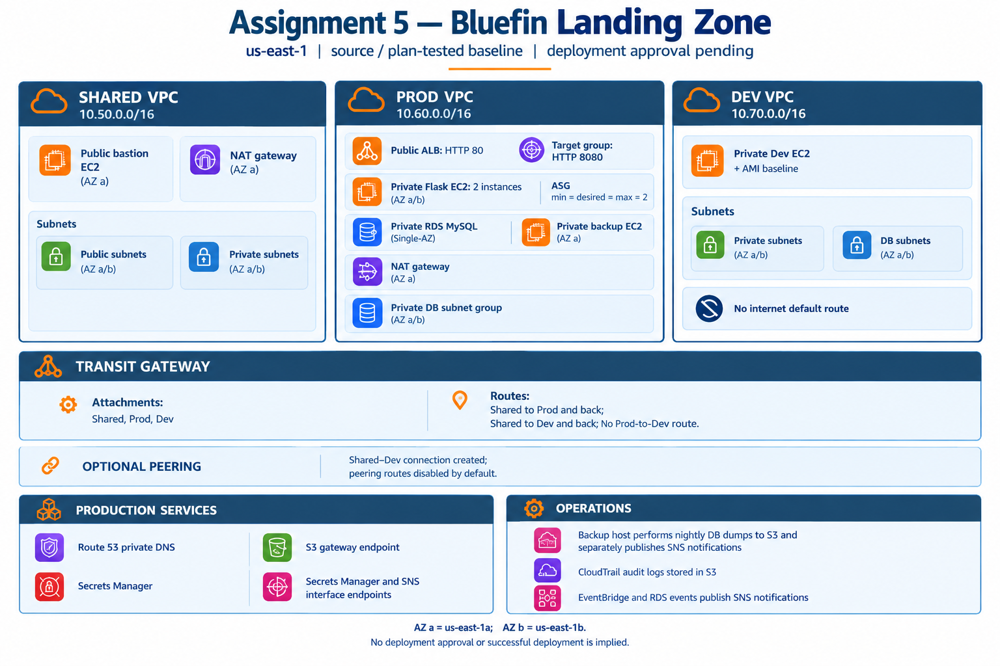

# Assignment 5 — Bluefin AWS Landing Zone

A Terraform lab combining shared services, isolated production/development networks, and the Assignment 4 warehouse inventory application.

## Status and selected baseline

This repository follows the current source/plan-tested baseline, not the earlier Mumbai design. Deployment approval is pending. Nothing in this repository authorizes an apply.

| Setting | Baseline |
|---|---|
| AWS region | `us-east-1` |
| Availability zones | `us-east-1a`, `us-east-1b` |
| Shared VPC | `10.50.0.0/16` |
| Production VPC | `10.60.0.0/16` |
| Development VPC | `10.70.0.0/16` |
| Project/resource-name prefix | `bluefin-landing-zone` |
| SSH key-pair name | `bluefin-assignment-5` |
| Production capacity | Two private application instances; ASG min/desired/max = 2 |
| Database | One private RDS MySQL instance; not Multi-AZ |
| Optional peering | Shared–Dev connection enabled; peering routes disabled |

Existing Terraform resource labels, VPC map keys, subnet keys, and naming defaults are preserved from the repaired baseline. Resource addresses being unchanged does not guarantee a no-change plan: application user data changes and IAM policies require review. Keep your existing state and private settings; do not start a separate state to manage the same resources.

## Architecture



* Public application traffic passes through the production ALB on HTTP 80, its target group on HTTP 8080, and the two private Flask instances.
* Application instances connect to private MySQL on TCP 3306. The DB subnet group spans two AZs, but the database itself is Single-AZ.
* Shared-services access reaches Prod and Dev through a Transit Gateway. There is no direct Prod–Dev route.
* The public bastion accepts SSH only from the configured administrator IPv4 `/32`; private hosts accept SSH from the Shared VPC CIDR.
* The backup host initializes the schema and restricted app user, creates ten demo records, and runs nightly dumps at 02:00 UTC. It uploads to S3 and separately sends SNS notifications.
* Production uses an S3 gateway endpoint and Secrets Manager/SNS interface endpoints. CloudTrail writes audit logs to a separate S3 bucket.
* Shared and Prod each have one NAT gateway in AZ a. Dev has no internet default route.

The PNG is a high-level overview, not deployment evidence. See [project documentation](PROJECT-DOCUMENTATION.md) for exact subnets, limitations, and resource behavior.

## Repository structure

```text
Assignment-5/
  README.md
  PROJECT-DOCUMENTATION.md
  SOURCE-NOTES.md
  UPLOAD-INSTRUCTIONS.md
  architecture.png
  app.py
  requirements.txt
  .gitignore
  templates/index.html
  SQL/schema.sql
  evidence/README.md
  tests/test_application.py
  terraform/
    .terraform.lock.hcl
    terraform.tfvars.example
    *.tf
    iam/*.json
    scripts/
```

The parent files are part of the Terraform deployment input. Keep the whole folder together: copying only `terraform/` will break the references to `app.py`, `requirements.txt`, and `templates/index.html`.

## Application source and deployment

The application retains Assignment 4's `/`, `/items`, and `/health` routes, `items` table, and separate HTML template. It is an adapted implementation, not a byte-for-byte GitHub export. Secrets Manager credential loading, TLS configuration, bounded validation, health/schema checks, and session-key handling were added for Assignment 5. See [source notes](SOURCE-NOTES.md) for provenance and changes.

Terraform embeds the local app, requirements, and template in EC2 user data. Instances do not clone GitHub or require a GitHub token. Gunicorn runs the app on port 8080 as the `bluefinapp` Linux user. Database initialization runs on the dedicated backup host; app targets can remain unhealthy until that initialization completes.

## Private configuration

Never commit your actual `terraform.tfvars`. Commit only `terraform/terraform.tfvars.example`, which deliberately contains invalid placeholders for account, AMI, owner, administrator address, and SSH keys.

Keep these private:

* Actual `*.tfvars`, AWS credentials, SSO cache, access tokens, `.env` files, and database passwords.
* Terraform state and backups, saved plans, plan JSON, and `.terraform/`.
* Private SSH keys, database dumps, and unredacted evidence.

Commit `.terraform.lock.hcl`: it is the provider dependency lockfile, not state. A `sensitive` variable hides normal display but does not encrypt Terraform state; this configuration stores database secrets in state.

## Review and validation workflow

For a new checkout only, copy the example locally:

```bash
cd terraform
cp terraform.tfvars.example terraform.tfvars
```

Fill every placeholder privately. Do not replace an existing private tfvars file with this template. Independently confirm the approved AWS account, region, available AZs, Amazon Linux 2023 x86_64 AMI, service quotas, SCP permissions, and intended costs. Configure AWS credentials through your approved local mechanism, never in source files.

Run the offline checks from the repository root:

```bash
python3 terraform/scripts/check-local.py
python3 -m unittest discover -s tests -v
```

When authorized to perform account-side validation and planning, use the existing state-bearing working directory and run:

```bash
cd terraform
terraform init
terraform fmt -check -recursive
terraform validate
terraform plan
```

Supply a new master password through Terraform's private interactive input, not a command-line argument or public file. Preserve the existing backend/workspace/state. Inspect all IAM changes, resource replacements, and deletions; do not apply without explicit mentor approval. An SCP deny cannot be overridden by granting more IAM permissions.

This revised GitHub package passed 9 offline Terraform/template consistency checks and 12 mocked application contract checks. Terraform CLI/provider validation, a fresh AWS plan for this revision, live Flask/MySQL integration, and deployment were not run in the packaging environment. Earlier validation/plan results do not validate this revised application integration.

## Validation evidence

The [evidence folder](evidence/README.md) is an empty evidence checklist, not a claim of completion. Add only real, approved, redacted results after testing. Suggested checks cover target health, inventory insert/read, private DNS, bastion SSH, network isolation, backups, notifications, audit logging, and IAM/MFA behavior.

## Important lab limitations

* HTTP-only public listener: no HTTPS certificate, authentication, or CSRF protection. Use only non-sensitive lab data.
* Two app instances do not make the full stack highly available: NAT is single-AZ per participating VPC, the database is Single-AZ, and the backup host is a single instance.
* ASG capacity is fixed at two; there is no CPU target-tracking policy.
* NACLs allow all traffic; security groups and routing provide the effective restrictions.
* Private database TLS validates the CA chain but not the hostname because the private CNAME differs from the RDS certificate name. This is not full hostname verification.
* App credentials are cached until process restart; credential rotation requires a coordinated application restart/refresh.
* RDS deletion protection is disabled and final snapshots are skipped in this lab baseline. Do not destroy without explicit approval and a verified recovery copy.
* Non-empty/versioned S3 buckets are protected by `force_destroy_buckets = false`; do not enable destructive cleanup casually.
* NAT gateways, TGW attachments, interface endpoints, ALB, EC2, RDS, storage, logs, and backups can incur ongoing charges.

## Publishing

Follow [upload instructions](UPLOAD-INSTRUCTIONS.md). Publishing source does not approve deployment. No Terraform state, private tfvars, private keys, passwords, saved plans, or fabricated evidence belong in GitHub.
